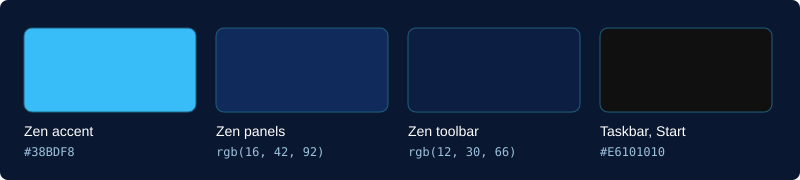

# Sky Desktop Theme

A matching look for Windows 11 and the Zen browser: a navy Zen and a taskbar and Start menu without blur.

[Русская версия](README.ru.md)

## Zen browser

1. Open `about:support` in Zen and open your profile folder.
2. Copy `zen/user.js` to the profile folder.
3. Copy `zen/userChrome.css` and `zen/userContent.css` to a `chrome` folder inside it.
4. Restart Zen.

If you already have files with these names, back them up first.

## Taskbar and Start menu

1. Install [Windhawk](https://windhawk.net) and these two mods: **Windows 11 Taskbar Styler** and **Windows 11 Start Menu Styler**.
2. Back up your settings for these mods if you have changed them, because the files overwrite them.
3. Run `windhawk/taskbar-no-blur.reg` and `windhawk/start-menu-no-blur.reg`. Windows will ask for administrator rights, since the settings live in `HKEY_LOCAL_MACHINE`.
4. Restart the mods in Windhawk.

## License

[MIT](LICENSE)
