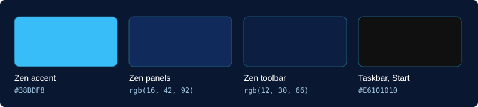

# Sky Desktop Theme

Единый стиль для Windows 11 и браузера Zen: тёмно-синий Zen, панель задач и меню «Пуск» без размытия.

[English version](README.md)

## Браузер Zen

1. Открой в Zen страницу `about:support` и перейди в папку профиля.
2. Скопируй `zen/user.js` в папку профиля.
3. Скопируй `zen/userChrome.css` и `zen/userContent.css` в папку `chrome` внутри неё.
4. Перезапусти Zen.

Если файлы с такими именами уже есть, сначала сохрани их копии.

## Панель задач и «Пуск»

1. Установи [Windhawk](https://windhawk.net) и два мода: **Windows 11 Taskbar Styler** и **Windows 11 Start Menu Styler**.
2. Если ты менял настройки этих модов, сохрани их копию: файлы их перезапишут.
3. Запусти `windhawk/taskbar-no-blur.reg` и `windhawk/start-menu-no-blur.reg`. Windows запросит права администратора, потому что настройки лежат в `HKEY_LOCAL_MACHINE`.
4. Перезапусти моды в Windhawk.

## Лицензия

[MIT](LICENSE)
